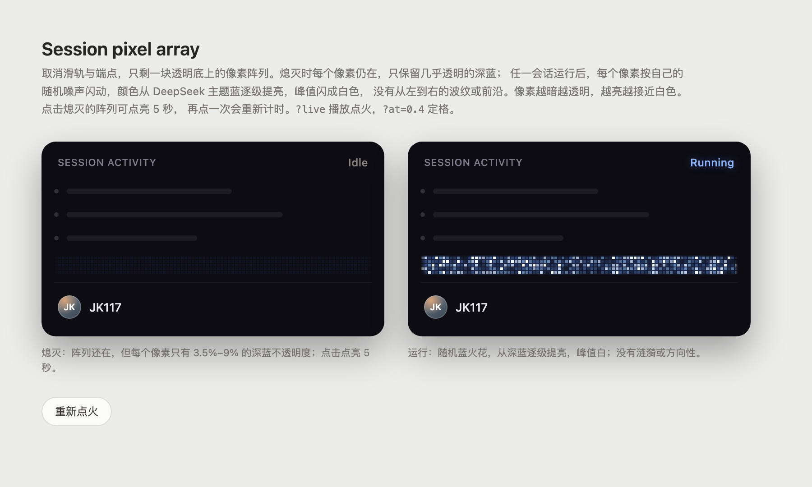
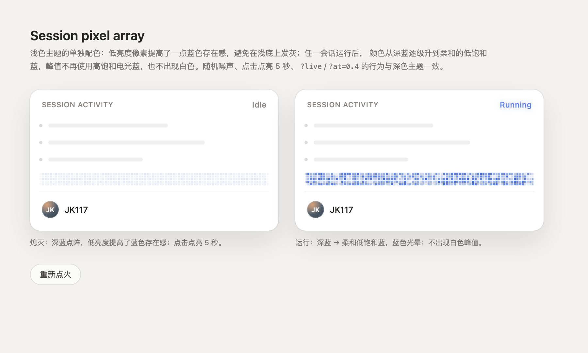

# dsh-pixel-flame-bar

DSH 桌面侧边栏插件：在账户行上方放一条透明像素阵列。所有 Session 空闲时几乎透明；任一 Session 运行时，像素按随机噪声闪动；点击空闲阵列可点亮 5 秒。

深色主题：DeepSeek 蓝 → 白。浅色主题：独立的深蓝 → 柔和低饱和蓝，避免浅底发灰、峰值过艳。





## 特性

- 透明背景，无滑轨、端点或 effort 开关；5 行 × 约 64 列（256px 宽），3px 像素块 + 1px 缝隙。
- 插在 `sidebar.footer.action`，位于 `sidebar.settings`（头像/设置行）上方。
- 任意 Session `running` 时点亮；熄灭时点击、Enter 或 Space 可亮 5 秒，重复点击重新计时，运行中点击忽略。
- 深/浅两套 palette；监听 `body[data-ds-dark-theme]` 自动切换，空闲或运行中都即时重绘。
- 9Hz / 2.1Hz 两层随机噪声，最多 0.5 秒随机点火延迟，无波纹或方向性；0.35 秒淡入淡出。
- `prefers-reduced-motion` 下只画静态帧；左右各 5px 边缘渐隐。

## 主题配色

| | 深色 | 浅色 |
| --- | --- | --- |
| 触发条件 | `body[data-ds-dark-theme]` | 无该标记 |
| 色阶 | `deepseek-500 → 450 → 400 → 300 → 200 → white` | `#1d4ed8 → #2563eb → #3b6bf5 → #5f7ef2 → #7a93f0` |
| 低亮度 | 深蓝 | 更饱和的深蓝，alpha ×1.4 |
| 峰值 | 纯白 | 柔和低饱和蓝，无白色 |
| 光晕 | `brightness(1.15) + 3px` 蓝晕 | `saturate(0.95) + 2px` 柔和蓝晕 |

浅色色值在 `src/flame.js` 的 `lightPalette`，阈值在 `pixelColor` 的 light 分支（0.8 / 0.58 / 0.38 / 0.18）。

## 安装

1. 构建：

   ```bash
   node scripts/build.mjs
   ```

2. 在 `~/.dsh/profiles/desktop/cordis.patch.yml` 中加入（把路径换成实际位置）：

   ```yaml
   - insert:
       - id: pixel-flame-bar
         name: /absolute/path/to/dsh-pixel-flame-bar/lib/index.js
   ```

3. `Cmd+R` 刷新窗口。**不需要重启应用**。

这是纯浏览器插件：Host half 为空实现，`name` 指向入口文件的绝对路径，不是 npm 包，也不需要 `pnpm add`。

## 开发与预览

```bash
node scripts/build.mjs        # 重新生成 lib/client.js
node --check lib/client.js    # 语法检查
node scripts/smoke-test.mjs   # 冒烟测试

open preview/index.html         # 深色预览
open preview/light.html         # 浅色预览
open "preview/index.html?live"  # 播放随机点火
open "preview/index.html?at=0.4" # 定格秒数
```

修改 `src/` 后必须重新 build；`lib/client.js` 是运行产物。

## 常用调参

| 想改什么 | 位置 |
| --- | --- |
| 像素大小 / 缝隙 / 行数 | `src/flame.js` 的 `cell`、`gap`、`Math.min(5, …)` |
| 空闲透明度 | `src/flame.js` 的 `0.035 + hash(...) * 0.055` |
| 运行底阵 / 增益 | `src/flame.js` 的 `idleAlpha * 0.9`、`* 1.5`（浅色 `* 1.6`） |
| 噪声频率 / 延迟 | `src/flame.js` 的 `time * 9`、`time * 2.1`、`seed * 0.5` |
| 疏密 | `src/flame.js` 的 `mask < 0.18`、`0.45`、`energy < 0.04` |
| 深色白色火花 | `src/flame.js` 的 `sparkle > 0.985` |
| 深色色阶阈值 | `src/flame.js` 的 `pixelColor`：0.8 / 0.58 / 0.38 / 0.22 / 0.08 |
| 浅色 palette / 阈值 | `src/flame.js` 的 `lightPalette`、`pixelColor` light 分支 |
| 点击点亮时长 | `src/client.js` 的 `setTimeout(..., 5000)` |
| 光晕 | `src/lightbar.css` 的 `[data-active="true"]` 过滤器 |

改完执行 `node scripts/build.mjs`，刷新窗口。

## 卸载

删除 `cordis.patch.yml` 中 `pixel-flame-bar` 的整个 `- insert:` 块（连同注释），刷新窗口即可。

本机若保留了不含本插件的 profile 快照 `cordis.patch.yml.before-lightbar`，也可以用它恢复；该文件已在 `.gitignore` 中排除，不会进入仓库。

## 已知限制

- 只对 Web 客户端生效（`dsh.client.platform: "web"`），不影响 TUI/ACP。
- 以绝对路径挂载，适合本地开发/自用；分发给别人需要按官方 bundle 规范打包。
- 它是普通 Loader 行而非 bundle，不会出现在侧边栏「插件」列表里；开关方式是编辑 profile 补丁。
- 灯条只反映 Host 的 Session `running` 状态，不推断等待审批、后台任务等语义。
- 点击点亮是本地 5 秒预览，不改变 Host 状态；运行中点击被忽略。
- 浅色 palette 是内置色值，不跟随 DSH 语义 token 自动变化。
- 当前是 SDR canvas 效果；真 HDR 的 Web/EDR 方案见 [docs/hdr-options.md](docs/hdr-options.md)，仅为设计文档，未实现。

## 结构

```text
src/client.js    # React 组件、slot 注册、点击逻辑
src/flame.js     # canvas 像素阵列、主题 palette、随机噪声
src/lightbar.css # 透明容器、光晕、边缘 mask
lib/             # 构建产物
preview/         # 深色/浅色静态预览
docs/            # 真 HDR 方案（未实现）
scripts/         # build + smoke test
```
